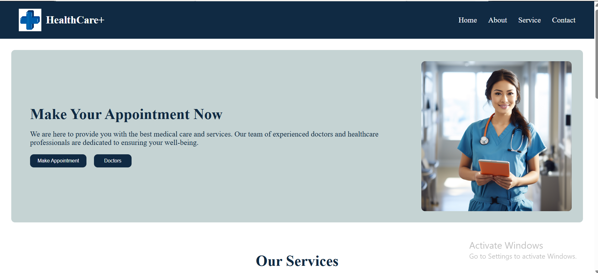

# 🏥 Doctor Portal Landing Page

A modern and user-friendly Doctor Portal Landing Page built with HTML5 and CSS3. This project features a clean design for presenting healthcare services and medical information.

## ✨ Features

- Clean and professional design
- Navigation bar
- Hero section
- Healthcare services section
- Doctor information section
- Contact section
- Responsive layout (if implemented)

## 🛠️ Technologies Used

- HTML5
- CSS3

## 📸 Project Preview

<!-- Add your project screenshot here -->



## 🚀 How to Run

1. Clone this repository:

   ```bash
   git clone YOUR_REPOSITORY_URL
   ```

2. Open the project folder in VS Code.

3. Open `index.html` in your browser.

## 📂 Project Structure

```text
Doctor-Portal/
├── index.html
├── style.css
├── images/
└── README.md
```

## 🎯 Purpose

This project was created to practice HTML and CSS skills by designing a healthcare landing page with a clean and professional layout.

## 👩‍💻 Author

**Sayeda Rumaiya Islam**

Full Stack Developer

---

⭐ Thank you for visiting my project!
